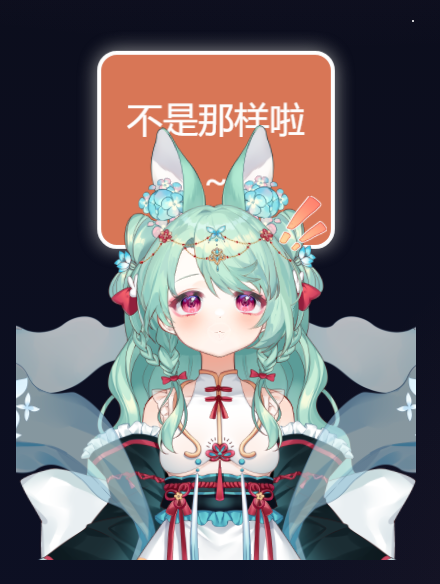
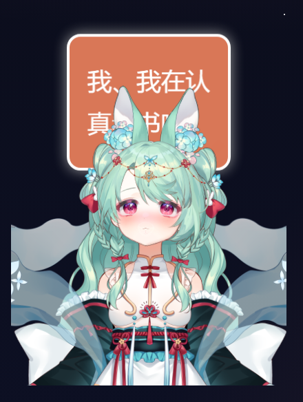

# 阅读页 Live2D 看板娘

## 范围与来源

只在文章页（`/blog/<slug>/`）加载的 Live2D 看板娘：鼠标移动时眼睛与头部跟随光标，点击角色在「摇头」与「害羞」之间交替反应并显示对应中文气泡；首页、`/room/`、栏目页与归档页完全不加载，移动端与窄屏也不加载。角色是阅读时的陪伴层，不参与文章导航、不播放音频、不请求后端。

- 运行时：`oh-my-live2d@0.19.3`（精确锁版本，MIT），单个自包含 ESM 包，**内嵌 Cubism 2 与 Cubism 4/5 Core**，因此无需另外搬运专有 Core 文件，也不需要外部 CDN。
- 模型：**小书仙青兔**（Cubism 4，4000×7000 画布，7 张 4096 贴图，共 56.74 MB），来自你提供的本地包 `D:\Desktop\小书仙青兔 (3).zip`（47.9 MB，2026-10-16）。包内没有许可文件，也没有作者字段（其 `*.vtube.json` 是 VTube Studio 工程，`Name` 为「小书仙青兔」）。
- 包内 23 个 `exp3.json` 与 `Scene1.motion3.json` **原本没有登记进 model3.json**，本地清单补登了全部表情，并把 `Scene1` 登记为动作组 `Shake`。原始 moc3、贴图、physics、cdi3 与表情文件均按原样保留；未采纳 `*.vtube.json`、`items_pinned_to_model.json` 与预览图。
- 反应映射：点击第 1、3、5… 次播 `Shake`（`Scene1` 让头部参数在 -30 与 30 之间来回摆）+ 表情 `惊讶`；第 2、4、6… 次播表情 `脸红`。
- 许可：**来源与授权未知**——压缩包里没有任何许可或说明文件。把素材提交进公开仓库、通过 GitHub Pages 对外分发属于对外发布素材，请先确认原作者是否允许；`public/licenses/qingtu-live2d-model.txt` 记录了来源、未采纳文件与撤回方式，撤回只需删除 `public/live2d/qingtu/` 并把 `MODEL` 改回 `null`。




## 技术选型与取舍

| 取舍                    | 结论与理由                                                                                                                                                                                                                                                                                                     |
| ----------------------- | -------------------------------------------------------------------------------------------------------------------------------------------------------------------------------------------------------------------------------------------------------------------------------------------------------------- |
| 运行时                  | `oh-my-live2d@0.19.3`。单文件零依赖、内嵌两代 Cubism Core、原生支持 Cubism 2/4/5（网盘模型格式未知，这点是决定性的）、自带气泡文案层与点击区域。备选 `pixi.js@6 + pixi-live2d-display@0.4.0` 需要自备专有 Core，且上游 2022 年后停更。                                                                         |
| 加载时机                | 首屏不加载。文章页脚本先做门控，再用 `requestIdleCallback`（无则 1.2s 定时）动态 `import('oh-my-live2d')`，模型分块不进首屏请求，由 `tests/live2d.test.ts` 断言。                                                                                                                                              |
| 鼠标跟随                | 库默认只在角色包围盒内跟随（pixi 把 `pointermove` 绑在 `document` 上、再按包围盒命中分发）。项目在 `document` 上自行监听 `pointermove`（rAF 节流），换算成舞台局部坐标后调用模型的 `focus()`，因此**指针在页面任意位置都会跟随**；离开舞台两倍尺寸范围时缓动回中下方。左右镜像只有 `MODEL.mirror` 一个调参点。 |
| 点击反应（摇头 / 害羞） | `pointerdown`+`pointerup` 判定为一次轻点（位移 ≤9px、滚动 ≤2px、<700ms、主指针）后：先 `stopAllMotions()` 停掉库自带的点击动作，再播我们选定的动作组，最后用 `tipsMessage()` 弹出对应文案。第 1、3、5… 次为摇头（动作组 `Shake` + 表情 `惊讶`），第 2、4、6… 次为害羞（表情 `脸红`）。                         |
| 舞台位置                | 库默认把舞台 `position: fixed` 钉在视口左下角，会与「隐藏看板娘」按钮重叠。实测 `stageStyle` 传入 `left` / `bottom` 会被写到内联样式并生效，因此舞台抬到 `bottom: 4.5rem`，按钮留在 `bottom: .75rem`，两者不遮挡。                                                                                             |
| 构图                    | 模型原生画布 4000×7000，先用 `getBoundingClientRect` 与运行时实测确认尺寸关系，再逐档截图调到「兔耳到腰」的半身构图：`scale 0.083`、`position [-65, 5]`，舞台 200×260。1024–1279px 用 168×220 舞台，同一组参数会自然收成更紧的半身。                                                                           |
| 静音                    | `volume: 0`，沿用房间「不播放音效」的既有取舍。                                                                                                                                                                                                                                                                |
| 隐藏偏好                | 本地键 `lllllei-live2d-hidden`，与房间的 `lllllei-study-*` 完全独立；隐藏时调用 pixi 应用的 `stop()` 停止渲染循环，只保留 44×44 的「叫回看板娘」按钮，不销毁实例以避免反复创建。                                                                                                                               |
| 层级                    | 容器 `z-index: 30`，低于返回顶部（40）、悬浮导航（45）、阅读进度（50）与灯箱（200），永不遮挡控制件；容器 `pointer-events: none`，只有舞台与按钮可点击。                                                                                                                                                       |

## 库内部结构的使用与降级

`oh-my-live2d` 实例上的 `models`、`pixiApp` 字段在类型上是 `private`，运行时属性存在（库自身的 `playMotion` 也是通过 `models.model` 实现）。项目把这类访问集中在 `bridge.ts` 一处，全部用可选链 + `try/catch`，任何一步取不到都只影响那一步：

- 跟随：退化为库自带的包围盒内跟随；
- 动作：退化为库自带的点击区域动作（模型自带的动作组）；
- 文案：**始终显示**，这是唯一 100% 保证的反馈；
- 渲染暂停：取不到 pixi 应用时退化为仅隐藏 DOM。

## 文件与数据流

```
src/components/live2d/
├── CharacterDock.astro  容器、显示/隐藏按钮、状态行、样式与入口脚本
├── character.ts         门控 → 空闲加载 → 跟随 / 点击 / 隐藏 / 清理
├── config.ts            模型清单、舞台尺寸、文案、偏好键（唯一调参处）
├── gate.ts              加载门控（视口 / 指针 / 减少动效 / 省流 / 页面可见 / WebGL / 用户隐藏）
├── manifest.ts          Cubism 2 与 4 的 manifest 解析（动作组与表情清单）
├── model.ts             反应规划与文案轮转（纯函数）
├── pointer.ts           指针 → 舞台局部坐标、钳制、远离回落（纯函数）
├── tap.ts               点击判定（纯函数，与房间同一套阈值）
└── bridge.ts            库实例的可选访问层
```

`src/layouts/BlogPost.astro` 只新增一行 `<CharacterDock />`；模型路径只写进 `data-live2d-model`，不写 `href`/`src`，以免触发站点「所有站内链接必须可解析」的断言。

## 门控与降级

| 情形                               | 行为                                                             |
| ---------------------------------- | ---------------------------------------------------------------- |
| 视口 <1024px 或非精细指针（触屏）  | CSS 不显示，JS 不加载分块                                        |
| `prefers-reduced-motion: reduce`   | 不自动加载；按钮仍可手动叫出                                     |
| `navigator.connection.saveData`    | 不加载                                                           |
| 页面初始为后台标签页               | 等 `visibilitychange` 再走一次门控                               |
| 无 WebGL                           | 状态行提示「当前浏览器不支持 WebGL」，不加载分块                 |
| 分块或模型加载失败                 | 状态行提示「看板娘没加载出来，不影响阅读」，清空舞台，按钮可重试 |
| pixi 上下文丢失 / 页面进入 bfcache | 进入缓存时暂停渲染，返回时按偏好恢复                             |
| 用户点「隐藏看板娘」               | 记录偏好、停止渲染、隐藏舞台，只留按钮                           |

## 验收方式

- `npm test`：构建后检查 19 个页面、搜索、首页光照、三维路线、助手，以及 `tests/live2d.test.ts` 的 10 项（纯函数、门控、指针换算、点击判定、manifest 解析、模型资产完整性、容器只出现在文章页、分块不进首屏）。
- `npm run format:check`、`npx tsc --noEmit`。
- 浏览器人工检查（1440 / 1280 / 1024 / 375）：鼠标跟随、点击摇头与害羞交替且气泡文案不连续重复、隐藏后刷新仍保持、`prefers-reduced-motion` 下不自动加载、无 WebGL 时的提示、页面隐藏与返回。
- 断点遮挡：任一断点下左侧文章列表最后一项仍可点击、可聚焦；被遮挡时按 `config.ts` 的 `STAGE` 收窄舞台。
- 性能：文章页首屏请求不含看板娘分块；后台标签页不产生渲染帧。

## 实测验收记录

### 2026-10-16（小书仙青兔，当前）

- 加载：1440×900 下 `data-live2d-ready="true"`，模型画布 4000×7000、`scale 0.083` 后 332×581，舞台 `left: 12px / bottom: 72px`；`/live2d/qingtu/**` 的 manifest、moc3、7 张贴图、physics 全部 200（中文文件名按 UTF-8 百分号编码请求）。
- 运行时清单：动作组 `Shake`，表情 23 个（`脸红`、`惊讶` 等都在），控制台无错误日志。
- 交互：CDP 点击角色两次，第一次出现摇头文案「不是那样啦～」并切到 `惊讶` 表情，第二次出现害羞文案「我、我在认真看书啦。」并切到 `脸红`（截图见文首两张图）。
- 资产体积 56.74 MB，最大单文件 `小书仙青兔.moc3` 23.35 MB，均在 GitHub 100 MB/文件限制内；测试预算上限相应放宽到 80 MB。

### 2026-10-06（Live2D 官方样本 Natori，已被小书仙青兔替换）

- 构建：`astro build` 19 个页面；`npm test` 全部通过；`npx tsc --noEmit` 与 `npm run format:check` 通过。
- 加载：`data-live2d-ready="true"`，Cubism Core 版本 `05.00.0000`，画布 400×520（DPR 2）。
- 交互：点击两次分别命中摇头与害羞文案，与交替规则一致。
- 门控：1000px 视口下 `display: none` 且**没有创建 canvas**；`--force-prefers-reduced-motion` 下同样不加载；首次点「隐藏看板娘」后 `data-live2d-off="true"`、舞台隐藏、按钮变为「叫回看板娘」，同一 profile 重新打开页面仍保持隐藏且不创建 canvas。
- 调试入口：URL 带 `?live2d-debug` 时把库实例挂到 `window.__live2d`，可在浏览器里直接调 `setModelScale` / `setModelPosition` / `setStageStyle` 做构图微调，正式访问不带该参数时不会暴露任何对象。

## 开工基线（2026-10-06）

本次改动只新增 `src/components/live2d/**`、`tests/live2d.test.ts`、`docs/live2d/**`，并在 `BlogPost.astro`、`package.json`、`.gitignore`、`.gitattributes` 上做加法；工作树里原有的 8 个未提交文件（`IllustratedHome.astro`、`illustration/home.ts`、`room/{Room.astro,furniture3d.ts,life.ts,scene3d.ts}`、`tests/{character,room}.test.ts`）与未跟踪的 `public/art/room/` 一律不动。

## 已知限制

- 库没有暴露销毁方法，隐藏时通过 pixi 应用的 `stop()` 暂停渲染；页面整体卸载依赖浏览器回收。
- 内部字段访问属于运行时约定，已锁版本并做全量降级，升级 `oh-my-live2d` 前需要重新验证跟随与动作。
- `oh-my-live2d@0.19.3` 的 `showModelHitAreaFrames()` 与 `hideModelHitAreaFrames()` **实现互换**（前者实际移除、后者实际添加）。项目不调用这两个方法；调试点击区域时按这个实际行为使用。
- 模型体积会永久增加仓库与部署产物：小书仙青兔解出后 56.74 MB（`.moc3` 23.35 MB、7 张 4096 贴图合计约 33 MB）。GitHub 单文件上限 100 MB，仓库建议上限 1 GB；`tests/live2d.test.ts` 的预算断言上限为 80 MB。如需大幅瘦身，可用 Cubism Editor 降低贴图分辨率后重新导出。
- **构建与测试必须用 Node 22**（仓库 CI 亦为 22）。Node 26 下 `astro sync` 会在 `picomatch` 上报 `require is not defined`，构建直接失败；本机 Node 22 路径为 `C:\Users\60421\AppData\Roaming\fnm\node-versions\v22.22.2\installation`。
